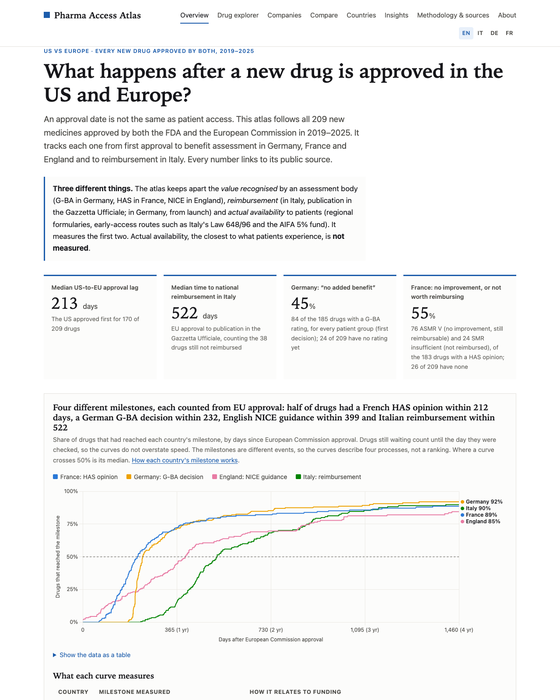

# Pharma Access Atlas

**What happens after a new drug is approved in the US and Europe? A fully sourced market-access dashboard covering every new medicine approved by both the FDA and the EU in 2019–2025 (209 drugs): benefit assessment in Germany, France and England, and reimbursement in Italy.**

**Live site → [lucamurri.github.io/pharma-access-atlas](https://lucamurri.github.io/pharma-access-atlas/)**
in English, [Italiano](https://lucamurri.github.io/pharma-access-atlas/it/), [Deutsch](https://lucamurri.github.io/pharma-access-atlas/de/) and [Français](https://lucamurri.github.io/pharma-access-atlas/fr/).

[](https://lucamurri.github.io/pharma-access-atlas/)

---

## The problem

A drug's approval date is the date that makes headlines, but it is not when patients get the drug. In Europe, an
EU-wide approval is followed by separate national decisions on price, reimbursement and added value. These can take
years and vary by country. The public data needed to see this is scattered across seven agencies, four
languages and formats ranging from APIs to official gazettes.

The atlas puts those pieces side by side for **all 209 new medicines** approved by both the FDA and the European
Commission in 2019–2025. They are selected by a fixed rule, not hand-picked. It tracks each drug from FDA approval
and EU approval to benefit assessment in **Germany** (G-BA), **France** (HAS) and **England** (NICE), and to
reimbursement in **Italy** (AIFA), plus Medicare price negotiation in the **US** where it applies.
**Every value links to its public source**, and anything that could not be verified is left blank and flagged.

The site has an overview with time-to-access curves, a filterable drug explorer, a one-page brief per drug, a
[side-by-side comparison](https://lucamurri.github.io/pharma-access-atlas/compare.html) of up to four drugs, a
[company scorecard](https://lucamurri.github.io/pharma-access-atlas/companies.html), a profile per country
([US](https://lucamurri.github.io/pharma-access-atlas/united-states.html), [Italy](https://lucamurri.github.io/pharma-access-atlas/italy.html) and three more) and seven written findings.

## Three key findings

*(Data as of 11 November 2026; full analysis on the [Insights](https://lucamurri.github.io/pharma-access-atlas/insights.html) page.)*

1. **After EU approval, four countries reach four different milestones.** EU approval came a median
   **213 days** after the FDA's. Counting the drugs still waiting (Kaplan–Meier), half of drugs had a French HAS
   opinion within **212 days** of EU approval, a German G-BA decision within **232**, English NICE guidance within
   **399** and Italian reimbursement within **522**. These are different events: Italy's milestone comes after the
   price is agreed, while Germany reimburses from launch and France and England assess before funding.
2. **Without the orphan rules, most drugs were rated as having no added benefit in Germany.** Of the 116 drugs assessed against an
   existing therapy, **72% showed no added benefit** for any patient group. All 69 drugs assessed under the orphan rules
   received a benefit rating.
3. **England often funds what Germany found no added benefit for.** Of the 63 drugs Germany found had no added benefit and NICE also
   appraised, **81% received a positive NICE decision**. Germany measures added benefit over a comparator; NICE
   judges value for money at the price offered.

## Methodology in brief

- **Drugs:** every new active substance whose first FDA approval (openFDA: new-molecular-entity NDAs and original
  BLAs, plus FDA-verified cell and gene therapies) and first EU centralised authorisation both fall in 2019–2025.
  Generics, biosimilars and diagnostics are excluded. The selection is cross-checked against FDA's official
  novel-approval lists for 2019–2025 (`pipeline/crosscheck_fda.py`); every listed drug is either included or left
  out for a stated reason. Two semaglutide brands are kept as labelled reference drugs for the Medicare comparison.
- **Time to access:** medians of national milestones count drugs still waiting, using Kaplan–Meier curves (a drug
  confirmed as "not yet" stays in the count until the day it was checked), so slow cases are not left out.
- **Measures:** US-to-EU approval lag; Italian time to national reimbursement (EC approval to publication in the
  *Gazzetta Ufficiale*); German AMNOG rating (first G-BA decision); French HAS SMR and ASMR; NICE first decision;
  orphan status; and Medicare negotiated price where CMS publishes one. Therapy areas come from ATC codes.
- **Rules:** no estimates. Each value carries a `source_url` and a `retrieved_date`. A validation step blocks
  publication if a value lacks a source, if dates are illogical (for example, reimbursement before approval) or if a
  drug is duplicated. A text check confirms that every number in the written analysis matches the data.
- **Coverage:** prices are limited to what CMS publishes. US list prices and European net prices are not public.
  Full definitions and limitations are on the [Methodology](https://lucamurri.github.io/pharma-access-atlas/methodology.html) page.

| Source | Fields | Collection |
|---|---|---|
| openFDA (Drugs@FDA) | FDA approval date, applicant | API, refreshed monthly |
| EMA medicine data | CHMP opinion, EC approval, EU orphan, conditional approval | Download, refreshed monthly |
| CMS Drug Price Negotiation | Selection, Maximum Fair Price | Data file, refreshed monthly |
| French public medicines database (BDPM) | HAS SMR, ASMR and opinion date | Download, refreshed monthly; gaps from HAS open data and opinions |
| NICE | England appraisal outcome, date, TA number | Manual, sourced CSV |
| Gazzetta Ufficiale / AIFA | Italian reimbursement date and class; AIFA innovativeness and procedure dates from the same determination | Manual, sourced CSV (extracted from the full text) |
| G-BA | AMNOG decision date and rating | Manual, sourced CSV |
| FDA Novel Drug Approvals lists | Cross-check of the drug selection, 2019–2025 | One-off check (`pipeline/crosscheck_fda.py`) |
| FDA OOPD, CBER, CMS fact sheets | US orphan designation, cell and gene therapy dates, list price | Manual, sourced CSV |

## Tech stack

- **Data pipeline:** Python, standard library only (nothing to install). The code fetches, merges, validates and
  reports coverage. See [`pipeline/`](pipeline/).
- **Site:** static HTML, CSS and JavaScript, with [Chart.js](https://www.chartjs.org/) stored in the repo (no CDN,
  no framework, no tracking). Drug briefs are generated as static pages.
- **Hosting and automation:** GitHub Pages and GitHub Actions on the free tier. Every push is validated and
  deployed, and a monthly job refreshes the automatable sources, committing only if something changed.
- **Accessibility:** passes an automated axe-core WCAG 2.1 AA audit in light and dark mode. It supports keyboard
  navigation, and every chart has a data-table alternative.

```
pipeline/           universe.py (drug selection); crosscheck_fda.py (checks it against FDA's lists);
                    fetch_*.py → build.py → validate.py → coverage.py;
                    watch_has.py (flags new HAS opinions); analysis.py, so_what.py, check_text.py, i18n.py, build_site.py
data/raw/           trimmed extracts of the downloaded sources
data/manual/        hand-maintained CSVs (one sourced fact per row; see its README)
data/processed/     drugs.json: every field with value, status, source and date
site/               page templates, CSS, JS
.github/workflows/  deploy.yml (on push) and refresh.yml (monthly)
```

### Run it locally

Requires Python 3.9 or later.

```bash
git clone https://github.com/lucamurri/pharma-access-atlas.git
cd pharma-access-atlas
python3 pipeline/run_all.py            # fetch sources, build, validate, show coverage
python3 pipeline/build_site.py         # build the site into _site/
python3 -m http.server 8000 --directory _site   # open http://localhost:8000
```

Use `python3 pipeline/run_all.py --offline` to rebuild from the committed data without downloading, and
`python3 -m unittest discover pipeline` to run the validator tests. To update a hand-maintained value, edit
the CSVs in `data/manual/` as described in [`data/manual/README.md`](data/manual/README.md).

## Licence

- **Code:** [MIT](LICENSE).
- **Data:** each source keeps its own terms.
  - US federal data (FDA, CMS) is in the public domain.
  - EMA content may be reused with acknowledgement.
  - AIFA open data is CC BY 4.0, and Italian official acts are not subject to copyright.
  - G-BA decisions may be reused provided they are not distorted.
  - BDPM (France) data is under the Licence ouverte: cite the source and do not alter it.
  - NICE guidance is cited with links to the original pages.
- **Chart.js:** MIT, © Chart.js contributors.

*Not medical, legal or investment advice. Independent project, not affiliated with any agency or company named.*

---

**Luca Murri** · Master in Management, University of Chicago Booth School of Business (2027) ·
[LinkedIn](https://www.linkedin.com/in/lucamurri)

## Languages

The site is built in English, Italian, German and French (`pipeline/i18n.py`). Page texts live in
`site/pages/` (English) and `site/pages/i18n/<lang>/`; everything else (navigation, briefs, chart labels, the
generated "so what" sentences) in `site/i18n/<lang>.json`. The build stops if a translation misses a key or
changes a placeholder, so a number can never be dropped from a translated sentence. Numbers and dates follow
local conventions. To change a wording, edit the English and the three translations together.

